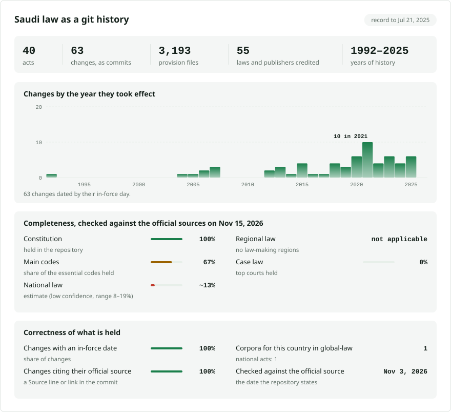

# Saudi Arabia: law history in git

[العربية](README.md) · **English**

<picture>
<source media="(prefers-color-scheme: dark)" srcset="data/effort-dark.svg">

</picture>

The law of Saudi Arabia as a git history: one file per article, one commit per version on the day it took effect, and the royal decree or order that made each change as the commit's author. `git blame` names the decree or order behind every paragraph; `git log` lists every change to an article; picking a date gives the text in force that day.

Part of [lexifina/global-law](https://github.com/lexifina/global-law), one git history for every country's law: this is Saudi Arabia's national law, which global-law reads at `saudi-arabia/national/acts/`.

**What is in it now:** 40 laws from the laws portal of the Bureau of Experts at the Council of Ministers, with 63 versions: each law as enacted (the Basic Law of Governance of 1992 and 39 laws in force from 2004 to 2025; the Commercial Register Law is here twice, from two pages of the portal) and 23 later versions of six of them, made by the royal decrees and orders that amended them (9 of the Law of Procedure before Sharia Courts, 7 of the Labour Law). The portal prints only each law's original text, with its amendments as notes under the articles, so every later version is that text with the notes applied. [`instruments.csv`](instruments.csv) lists every version, by law, with its Gregorian and Hijri dates and how its in-force day was read.

Each law is a folder with one file per article (`labour-law/` is نظام العمل, the Labour Law, Royal Decree M/51 of 23/8/1426 H, and `labour-law/article-074.md` its Article 74, on the end of the employment contract; `labour-law/article-011-bis.md` is its Article 11 مكرر). Laws without a short English name are named by their decree (`law-m-91-1443/` is Royal Decree M/91 of 19/9/1443 H). Each folder's `preamble.md` holds the issuing instrument and `structure.md` its parts and chapters.

The text is in Arabic, as the portal prints it, errors included; only the Official Gazette (Umm al-Qura) is authoritative. The portal's English translations are not part of this record.

## Questions as git commands

| Question | Command |
| --- | --- |
| Every change to Article 74 of the Labour Law | `git log -p --word-diff -- labour-law/article-074.md` |
| Which decree wrote each line of Article 74? | `git blame labour-law/article-074.md` |
| Every version of the Labour Law, with the day each took effect | `git log --format="%h %(trailers:key=In-force,valueonly,separator=) %an" -- labour-law` |
| Article 74 as in force on 1 January 2016 | `python tools/salaw.py 2016-01-01 labour-law 74` |

**Outside git**, we also host this record publicly, for free:

- **[Ask Claude about Saudi law](https://global-law.lexifina.com/v1/try_claude?country=saudi-arabia)**: opens Claude with a first question ready.
- **[Ask ChatGPT](https://global-law.lexifina.com/v1/try_chatgpt?country=saudi-arabia)**: the same question in ChatGPT.
- **[Search Saudi law on our site](https://lexifina.com/law?country=saudi-arabia&q=%D8%A5%D8%AC%D8%A7%D8%B2%D8%A9+%D8%B3%D9%86%D9%88%D9%8A%D8%A9)**: a search for "إجازة سنوية" (annual leave), with each provision's text and its versions, no account needed.
- **[Developer REST API](https://global-law.lexifina.com/v1/search_law?query=%D8%A5%D8%AC%D8%A7%D8%B2%D8%A9+%D8%B3%D9%86%D9%88%D9%8A%D8%A9&jurisdiction=saudi-arabia)**: the same search as JSON, with no key. See the [documentation here](https://lexifina.com/api/global-law).

Both assistants read the record through the free Global law connector (MCP, `https://global-law.lexifina.com/mcp`); the first time, the chat gives you the link that adds it. Ask in Arabic or in English.

**Host it yourself easily.** All it takes is git and Python, and the tools run on your machine:

```sh
git clone --depth 1 https://github.com/lexifina/global-law && cd global-law
python3 tools/countries.py add saudi-arabia/national/acts
python3 tools/law.py show 2026-01-01 saudi-arabia/national/acts/labour-law/article-074.md
```

Opened in Claude Code, Cursor, VS Code or Codex, the clone also starts a local MCP server with the same tools ([MCP.md](https://github.com/lexifina/global-law/blob/main/MCP.md)).

## Dates

Each commit is dated at noon, Asia/Riyadh, on the day the version took effect, and carries it in its `In-force:` trailer, with the Hijri (Umm al-Qura) date in `In-force-hijri:` and how the day was read in `In-force-basis:`:

- a law as enacted: its own commencement clause, counted from the publication day the portal gives (37 laws take effect a set number of days after publication, 3 on publication);
- an amendment whose notes give a day (Royal Decree M/44 of 8/2/1446 H, for the Labour Law): that day;
- the other 22 amendments: the day of the decree or order, as the notes give no publication or commencement day. Under Article 71 of the Basic Law a law takes effect on its publication in Umm al-Qura unless it says otherwise, so read these days as "not before".

Each version is credited to the royal decree or order that made it (`Royal Decree M/44 of 8/2/1446 H`, with an `.invalid` address), and each law as enacted to the instrument that issued it; a note naming several instruments is credited to the last one. The committer is Lexifina.

## How it is checked

- Every version is read back from git and compared with the portal's page for that law (the Internet Archive capture named in `REPRODUCE.md`): each article a version did not change must equal the original text byte for byte, and as a stream of letters and digits read from the raw page by a separate, minimal extractor.
- Each change an instrument made must consist only of words found in that instrument's notes. This shows each change is the notes' own words, not that the result matches an official consolidation: none is published.
- History is append-only. Laws added later were appended on top as their own commits, so `git log` lists them after the Basic Law and the Labour Law; `tools/salaw.py` reads each version by its `In-force:` trailer, not by its place in the log.
- [vulnerabilities/](vulnerabilities/README.en.md): possible drafting mistakes in this law, found by global-law's detectors and checked by hand. Not run yet.

## What it does not show

- **Official consolidated texts.** Only each law's first commit is the portal's own text; 13 amendment notes that could not be applied exactly are left out and named in `Not-applied:` trailers.
- **Most Saudi laws.** The others on the portal, and laws whose commencement could not be counted, are not here yet.
- **Implementing regulations, ministerial decisions and court decisions**: unchanged words do not mean unchanged law.
- **Amendments the portal does not record as notes**, and parts of a law that took effect later than the rest (Article 74(4) of the Labour Law, two years after the law), which are not separate commits.

## Sources

| Source | Kind | Past versions | Notes |
| --- | --- | --- | --- |
| [Laws portal of the Bureau of Experts at the Council of Ministers](https://laws.boe.gov.sa) (هيئة الخبراء بمجلس الوزراء) | Official legal portal: laws issued by royal decree or order, with their publication day | the original text, with the amendments as notes under each article | Arabic pages read through Internet Archive captures of 2025 and 2026 (listed in `REPRODUCE.md`), last read on 3 November 2026; English translations not used |

## Licence

See [`LICENSE`](LICENSE). The portal's terms of use make it available for personal use and publish no reuse licence; the texts are credited to the Bureau of Experts at the Council of Ministers, and only the Official Gazette (Umm al-Qura) is authoritative. Lexifina's history, commit messages, tables and tools are CC0 1.0.

No AI model wrote legal text or ran at build time; the code was written by an AI model, which also chose the laws and wrote their English names (see [`REPRODUCE.md`](REPRODUCE.md)).

## Visualisations

- [visualisations/](visualisations/README.en.md): charts drawn from this repository. Not drawn yet.

## More

From [lexifina/global-law](https://github.com/lexifina/global-law):

- [FEATURES.md](https://github.com/lexifina/global-law/blob/main/FEATURES.md): every feature, and what every corpus must support (`git blame`, `law.py`, the MCP tools)
- [FAQ.md](https://github.com/lexifina/global-law/blob/main/FAQ.md): questions and answers · [CONTRIBUTING.md](https://github.com/lexifina/global-law/blob/main/CONTRIBUTING.md): proposing changes · [MCP.md](https://github.com/lexifina/global-law/blob/main/MCP.md): the MCP server · [REPRODUCE.md](https://github.com/lexifina/global-law/blob/main/REPRODUCE.md): how it was built · [CHANGELOG.md](https://github.com/lexifina/global-law/blob/main/CHANGELOG.md)
- [FRESHNESS.md](https://github.com/lexifina/global-law/blob/main/FRESHNESS.md): how current each corpus is · [Monitoring](https://github.com/lexifina/global-law/tree/main/monitoring): whether updates are running · [WATCHING.md](https://github.com/lexifina/global-law/blob/main/WATCHING.md): how each official source is watched for changes
- [performance/](https://github.com/lexifina/global-law/tree/main/performance): how fast the tools are, measured
- [visualisations/](https://github.com/lexifina/global-law/tree/main/visualisations): charts and bridges across the world's law
- [Vulnerabilities](https://github.com/lexifina/global-law/tree/main/vulnerabilities): mistakes in legislation as published
