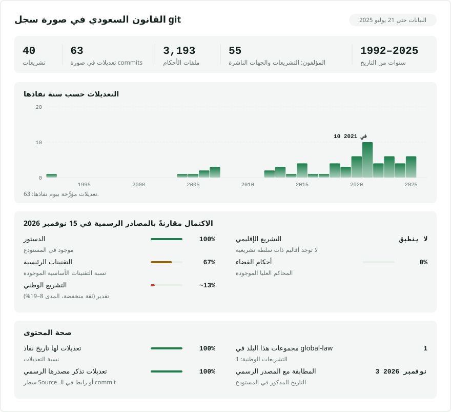

# المملكة العربية السعودية: تاريخ القانون في git

**العربية** · [English](README.en.md)

<picture>
<source media="(prefers-color-scheme: dark)" srcset="data/ar/effort-dark.svg">

</picture>

القانون السعودي في صورة سجل git: ملف واحد لكل مادة، وcommit واحد لكل نسخة في يوم نفاذها، والمرسوم الملكي أو الأمر الملكي الذي أجرى كل تعديل هو مؤلف الـ commit. يذكر `git blame` المرسوم أو الأمر الذي يقف وراء كل فقرة؛ ويسرد `git log` كل تعديل طرأ على مادة ما؛ واختيار تاريخ ما يعطي النص النافذ في ذلك اليوم.

جزء من [lexifina/global-law](https://github.com/lexifina/global-law)، وهو سجل git واحد لقوانين جميع الدول: هذا هو القانون الوطني السعودي، الذي يقرؤه global-law في `saudi-arabia/national/acts/`.

**ما يحتويه الآن:** 40 نظامًا من بوابة الأنظمة لهيئة الخبراء بمجلس الوزراء، في 63 نسخة: كل نظام كما صدر (النظام الأساسي للحكم لعام 1992 و39 نظامًا نفذت من 2004 إلى 2025؛ ويرد نظام السجل التجاري هنا مرتين، من صفحتين مختلفتين في البوابة) و23 نسخة لاحقة لستة منها، أوجدتها المراسيم والأوامر الملكية التي عدّلتها (9 لنظام المرافعات الشرعية، و7 لنظام العمل). لا تنشر البوابة إلا النص الأصلي لكل نظام، مع تعديلاته في صورة حواشٍ تحت المواد، لذا فكل نسخة لاحقة هي ذلك النص بعد تطبيق الحواشي عليه. يسرد [`instruments.csv`](instruments.csv) كل نسخة، مرتبة حسب النظام، مع تاريخيها الميلادي والهجري وكيفية تحديد يوم نفاذها.

كل نظام مجلد فيه ملف واحد لكل مادة (`labour-law/` هو نظام العمل، الصادر بالمرسوم الملكي رقم (م/51) وتاريخ 23/8/1426هـ، و`labour-law/article-074.md` هي المادة 74 منه، بشأن انتهاء عقد العمل؛ و`labour-law/article-011-bis.md` هي المادة 11 مكرر منه). وتُسمّى الأنظمة التي ليس لها اسم إنجليزي مختصر باسم مرسومها (`law-m-91-1443/` هو المرسوم الملكي رقم (م/91) وتاريخ 19/9/1443هـ). ويحتوي `preamble.md` في كل مجلد على أداة الإصدار، و`structure.md` على أبوابه وفصوله.

النص باللغة العربية، كما تنشره البوابة، بما فيه من أخطاء؛ ولا يُعتمد إلا على الجريدة الرسمية (أم القرى). والترجمات الإنجليزية في البوابة ليست جزءًا من هذا السجل.

## الأسئلة بصيغة أوامر git

| السؤال | الأمر |
| --- | --- |
| كل تعديل طرأ على المادة 74 من نظام العمل | `git log -p --word-diff -- labour-law/article-074.md` |
| أي مرسوم كتب كل سطر من المادة 74؟ | `git blame labour-law/article-074.md` |
| كل نسخ نظام العمل، مع يوم نفاذ كل منها | `git log --format="%h %(trailers:key=In-force,valueonly,separator=) %an" -- labour-law` |
| المادة 74 كما كانت نافذة في 1 يناير 2016 | `python tools/salaw.py 2016-01-01 labour-law 74` |

**خارج git**، نستضيف هذا السجل أيضًا للعموم مجانًا:

- **[اسأل Claude عن القانون السعودي](https://global-law.lexifina.com/v1/try_claude?country=saudi-arabia)**: يفتح Claude مع سؤال أول جاهز.
- **[اسأل ChatGPT](https://global-law.lexifina.com/v1/try_chatgpt?country=saudi-arabia)**: السؤال نفسه في ChatGPT.
- **[ابحث في القانون السعودي على موقعنا](https://lexifina.com/law?country=saudi-arabia&q=%D8%A5%D8%AC%D8%A7%D8%B2%D8%A9+%D8%B3%D9%86%D9%88%D9%8A%D8%A9)**: بحث عن "إجازة سنوية"، مع نص كل حكم ونسخه، دون الحاجة إلى حساب.
- **[واجهة REST API للمطورين](https://global-law.lexifina.com/v1/search_law?query=%D8%A5%D8%AC%D8%A7%D8%B2%D8%A9+%D8%B3%D9%86%D9%88%D9%8A%D8%A9&jurisdiction=saudi-arabia)**: البحث نفسه بصيغة JSON، دون مفتاح. انظر [التوثيق هنا](https://lexifina.com/api/global-law).

يقرأ كلا المساعدَين السجلَّ عبر موصل Global law المجاني (MCP، `https://global-law.lexifina.com/mcp`)؛ وفي المرة الأولى تعطيك المحادثة الرابط الذي يضيفه. اسأل بالعربية أو بالإنجليزية.

**استضِفه بنفسك بسهولة.** كل ما يلزم هو git وPython، والأدوات تعمل على جهازك:

```sh
git clone --depth 1 https://github.com/lexifina/global-law && cd global-law
python3 tools/countries.py add saudi-arabia/national/acts
python3 tools/law.py show 2026-01-01 saudi-arabia/national/acts/labour-law/article-074.md
```

عند فتح النسخة المستنسخة في Claude Code أو Cursor أو VS Code أو Codex، تشغّل أيضًا خادم MCP محليًا بالأدوات نفسها ([MCP.md](https://github.com/lexifina/global-law/blob/main/MCP.md)).

## التواريخ

يحمل كل commit تاريخ الظهر، بتوقيت Asia/Riyadh، من يوم نفاذ النسخة، ويذكر هذا التاريخ في حقله الختامي (trailer) `In-force:`، مع التاريخ الهجري (أم القرى) في `In-force-hijri:` وكيفية تحديد اليوم في `In-force-basis:`:

- النظام كما صدر: نص بدء النفاذ فيه، محسوبًا من يوم النشر الذي تذكره البوابة (37 نظامًا تنفذ بعد عدد محدد من الأيام من نشرها، و3 عند نشرها)؛
- التعديل الذي تذكر حواشيه يومًا محددًا (المرسوم الملكي رقم (م/44) وتاريخ 8/2/1446هـ، لنظام العمل): ذلك اليوم؛
- التعديلات الاثنان والعشرون الأخرى: يوم المرسوم أو الأمر، لأن الحواشي لا تذكر يوم نشر ولا يوم بدء نفاذ. وبموجب المادة 71 من النظام الأساسي للحكم، يُعمل بالنظام من تاريخ نشره في أم القرى ما لم ينص على خلاف ذلك، فاقرأ هذه الأيام على أنها "ليس قبل".

تُنسب كل نسخة إلى المرسوم الملكي أو الأمر الملكي الذي أوجدها (`Royal Decree M/44 of 8/2/1446 H`، بعنوان بريد ينتهي بـ `.invalid`)، وكل نظام كما صدر إلى الأداة التي أصدرته؛ والحاشية التي تذكر عدة أدوات تُنسب إلى آخرها. وصاحب الـ commit (committer) هو Lexifina.

## طريقة التحقق

- تُعاد قراءة كل نسخة من git وتُقارَن بصفحة البوابة الخاصة بذلك النظام (لقطة Internet Archive المذكورة في `REPRODUCE.md`): يجب أن تطابق كل مادة لم تغيّرها النسخة النص الأصلي بايتًا ببايت، وكذلك كسلسلة من الحروف والأرقام يقرؤها من الصفحة الخام مستخرِج مستقل ومبسَّط.
- يجب ألا يتكون كل تغيير أجرته أداة ما إلا من كلمات واردة في حواشي تلك الأداة. وهذا يبيّن أن كل تغيير هو كلمات الحواشي نفسها، لا أن النتيجة تطابق نصًا موحَّدًا رسميًا: إذ لا يُنشر أي نص من هذا القبيل.
- السجل لا يقبل إلا الإضافة. أُلحقت الأنظمة المضافة لاحقًا فوقه في commits خاصة بها، لذا يسردها `git log` بعد النظام الأساسي للحكم ونظام العمل؛ ويقرأ `tools/salaw.py` كل نسخة بحسب حقلها الختامي `In-force:`، لا بحسب موضعها في السجل.
- [vulnerabilities/](vulnerabilities/): أخطاء صياغة محتملة في هذا القانون، تكشفها أدوات global-law وتُراجَع يدويًا. لم تُشغَّل بعد.

## ما لا يتضمنه

- **النصوص الموحَّدة الرسمية.** لا يمثّل نصَّ البوابة نفسه إلا أولُ commit لكل نظام؛ وقد استُبعدت 13 حاشية تعديل تعذّر تطبيقها بدقة، وذُكرت في الحقول الختامية `Not-applied:`.
- **معظم الأنظمة السعودية.** الأنظمة الأخرى في البوابة، والأنظمة التي تعذّر حساب بدء نفاذها، ليست هنا بعد.
- **اللوائح التنفيذية والقرارات الوزارية والأحكام القضائية**: فثبات الألفاظ لا يعني ثبات القانون.
- **التعديلات التي لا تسجّلها البوابة في صورة حواشٍ**، وأجزاء النظام التي نفذت بعد بقيته (الفقرة (4) من المادة 74 من نظام العمل، بعد سنتين من النظام)، وهي ليست commits مستقلة.

## المصادر

| المصدر | النوع | النسخ السابقة | ملاحظات |
| --- | --- | --- | --- |
| [بوابة الأنظمة لهيئة الخبراء بمجلس الوزراء](https://laws.boe.gov.sa) (هيئة الخبراء بمجلس الوزراء) | البوابة القانونية الرسمية: الأنظمة الصادرة بمرسوم ملكي أو أمر ملكي، مع يوم نشرها | النص الأصلي، مع التعديلات في صورة حواشٍ تحت كل مادة | صفحات عربية قُرئت عبر لقطات Internet Archive من عامي 2025 و2026 (مدرجة في `REPRODUCE.md`)، وآخر قراءة في 3 نوفمبر 2026؛ الترجمات الإنجليزية غير مستخدمة |

## الترخيص

انظر [`LICENSE`](LICENSE). تتيح شروط استخدام البوابة محتواها للاستخدام الشخصي ولا تنشر أي ترخيص لإعادة الاستخدام؛ والنصوص منسوبة إلى هيئة الخبراء بمجلس الوزراء، ولا يُعتمد إلا على الجريدة الرسمية (أم القرى). أما السجل الذي أعدّته Lexifina ورسائل الـ commits والجداول والأدوات فخاضعة لـ CC0 1.0.

لم يكتب أي نموذج ذكاء اصطناعي نصًا قانونيًا ولم يعمل أي نموذج وقت البناء؛ أما الشيفرة فقد كتبها نموذج ذكاء اصطناعي، وهو الذي اختار الأنظمة أيضًا وكتب أسماءها الإنجليزية (انظر [`REPRODUCE.md`](REPRODUCE.md)).

هذا النص ترجمة للنسخة الإنجليزية ([README.en.md](README.en.md))؛ وعند الاختلاف تسود النسخة الإنجليزية.

## الرسوم البيانية

- [visualisations/](visualisations/): رسوم بيانية مستخرجة من هذا المستودع. لم تُرسم بعد.

## المزيد

من مستودع [lexifina/global-law](https://github.com/lexifina/global-law) (صفحات باللغة الإنجليزية):

- [FEATURES.md](https://github.com/lexifina/global-law/blob/main/FEATURES.md): جميع الميزات، وما يجب أن تدعمه كل مجموعة (`git blame`، `law.py`، أدوات MCP)
- [FAQ.md](https://github.com/lexifina/global-law/blob/main/FAQ.md): أسئلة وأجوبة · [CONTRIBUTING.md](https://github.com/lexifina/global-law/blob/main/CONTRIBUTING.md): اقتراح تغييرات · [MCP.md](https://github.com/lexifina/global-law/blob/main/MCP.md): خادم MCP · [REPRODUCE.md](https://github.com/lexifina/global-law/blob/main/REPRODUCE.md): طريقة البناء · [CHANGELOG.md](https://github.com/lexifina/global-law/blob/main/CHANGELOG.md)
- [FRESHNESS.md](https://github.com/lexifina/global-law/blob/main/FRESHNESS.md): مدى حداثة كل مجموعة · [المراقبة](https://github.com/lexifina/global-law/tree/main/monitoring): هل تعمل التحديثات · [WATCHING.md](https://github.com/lexifina/global-law/blob/main/WATCHING.md): كيف يُراقَب كل مصدر رسمي لرصد التغييرات
- [performance/](https://github.com/lexifina/global-law/tree/main/performance): سرعة الأدوات كما قيست
- [visualisations/](https://github.com/lexifina/global-law/tree/main/visualisations): رسوم بيانية وروابط عبر قوانين العالم
- [الثغرات](https://github.com/lexifina/global-law/tree/main/vulnerabilities): أخطاء في التشريعات كما نُشرت
